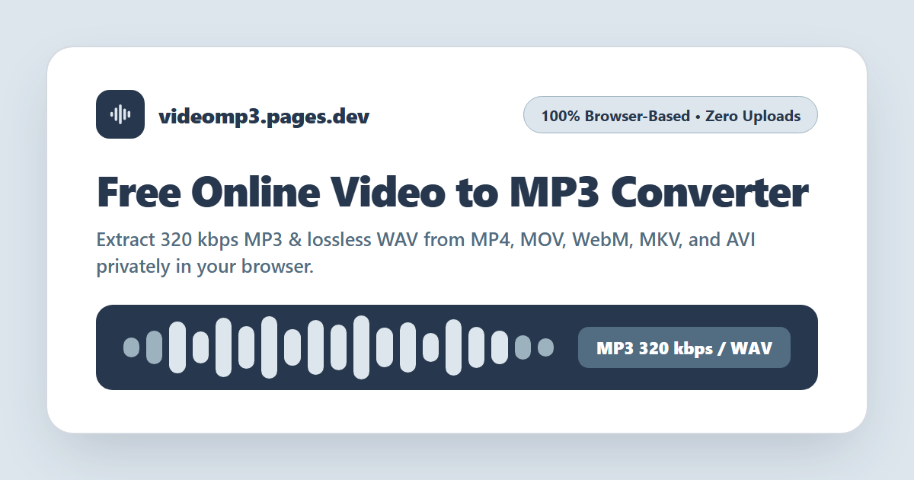
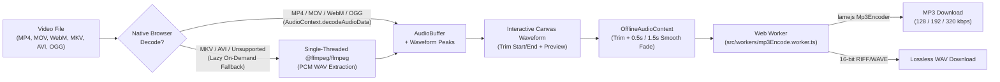

<div align="center">



# Video to MP3 Converter

**Privacy-first, 100% client-side Video to MP3 & WAV audio extractor built with Astro Islands, TypeScript, Tailwind CSS, Web Audio API, and WebAssembly.**

[Live App](https://videomp3.pages.dev) · [How to Use](https://videomp3.pages.dev/how-to-use) · [Hire the Developer](https://videomp3.pages.dev/hire-me) · [Buy Me a Coffee](https://kisharadilshan.gumroad.com/coffee)

[](https://videomp3.pages.dev)
[](https://astro.build)
[](https://react.dev)
[](https://www.typescriptlang.org)
[](https://tailwindcss.com)
[](https://pages.cloudflare.com)
[](./LICENSE)

</div>

---

## Overview

**Video to MP3 Converter** (`videomp3.pages.dev`) extracts crisp **MP3** (`128` / `192` / `320 kbps`) and **Lossless 16-bit PCM WAV** audio from video files **entirely inside the user's browser**. Files never leave the device, eliminating server queues, upload wait times, artificial file size limits, and cloud privacy concerns.

Designed around **Astro Islands Architecture** for instant first-paint static HTML and minimal JavaScript hydration, the application delivers a focused above-the-fold workspace paired with Light/Dark theming, an interactive High-DPI waveform trimmer, and instant switching across **8 languages**.

---

## Client-Side Audio Pipeline



### How the Dual-Path Engine Works

1. **Instant Native Fast Path (`src/lib/audio/decodeVideo.ts`)**
   Standard browser containers (`MP4`, `MOV`, `WebM`, `OGG`, `M4V`) are decoded natively using `AudioContext.decodeAudioData()` in milliseconds with zero external WASM downloads.
2. **Zero-Bloat Lazy WASM Fallback (`@ffmpeg/ffmpeg`)**
   When encountering `MKV`, `AVI`, `FLV`, `WMV`, or codecs not natively supported by the browser, `@ffmpeg/ffmpeg` (`@ffmpeg/core` single-threaded ESM) is dynamically imported on demand. Because single-threaded WASM does not require `SharedArrayBuffer`, the site avoids restrictive `COOP`/`COEP` headers that break embedded third-party frames.
3. **Sample-Accurate Trimming & Fade Smoothing (`src/lib/audio/renderTrimmed.ts`)**
   Uses `OfflineAudioContext` and a `GainNode` linear ramp to render the selected `[startSec, endSec]` slice with optional `0.5s` or `1.5s` fade-in/fade-out edges (with a direct `Float32Array` envelope fallback on memory-constrained devices).
4. **Off-Thread Web Worker Encoding (`src/workers/mp3Encode.worker.ts`)**
   Transfers PCM channel buffers to a dedicated module Web Worker running `@breezystack/lamejs` (`1152`-sample frames) or a custom RIFF/WAVE writer, streaming live percentage progress back to the main thread so the UI stays responsive.

---

## Feature Matrix

| Category | Capabilities |
| :--- | :--- |
| **Input Containers** | `MP4`, `MOV`, `WebM`, `MKV`, `AVI`, `OGG`, `M4V`, `3GP`, `FLV`, `WMV`, plus audio files (`MP3`, `WAV`, `M4A`, `AAC`) |
| **Output Presets** | `MP3 320 kbps` (Studio), `MP3 192 kbps` (Balanced), `MP3 128 kbps` (Compact), `WAV` (Lossless 16-bit PCM) |
| **Waveform & Trimming** | High-DPI `<canvas>` peaks, pointer & keyboard (`role="slider"`) Start/End handles, `MM:SS.d` inputs, click-to-seek preview |
| **Responsive Navigation** | Full desktop header (`lg:`) + ultra-minimal icons-only mobile/tablet navbar (`< lg`) with `44×44px` tap targets & `aria-label`s |
| **Support Integration** | In-app Gumroad Coffee modal (`role="dialog"`) with loading skeleton, Escape/backdrop dismiss, and styled fallback card |
| **Internationalization** | 8 languages (`en`, `es`, `pt`, `de`, `fr`, `ja`, `zh`, `ru`) with 100% key parity across **136** dictionary entries |
| **Theme System** | Light-default theme with instant `localStorage` inline `<head>` hydration (no FOUT) & smooth Dark theme toggle |
| **SEO & Analytics** | Flat `/sitemap.xml`, `robots.txt`, `SoftwareApplication` + `FAQPage` JSON-LD on `/`, `BreadcrumbList` on subpages, GTM & GA4 |

---

## Design System & Color Palette

The entire UI, waveform canvas, modal dialog, and Open Graph card strictly adhere to a unified four-color slate palette:

| Token | Hex | Light Mode Role | Dark Mode Role |
| :--- | :--- | :--- | :--- |
| **Deep Slate** | `#27374D` | Primary text & waveform stage | Page background |
| **Steel Blue** | `#526D82` | Primary buttons & muted text | Secondary borders & highlights |
| **Cool Mist** | `#9DB2BF` | Active highlights & borders | Primary accents & muted text |
| **Soft Ice** | `#DDE6ED` | Page canvas background | Primary typography & waveform peak highlights |
| **Surface Card** | `#FFFFFF` / `#1E2B3C` | Focal workspace card (`#FFFFFF`) | Focal workspace card (`#1E2B3C`) / stage (`#16202E`) |

---

## Project Structure

```text
extractaudio/
├── .github/
│   └── FUNDING.yml               # GitHub Sponsors / Gumroad Coffee pointer
├── public/
│   ├── _headers                  # Cloudflare Pages security & immutable /_astro/* caching
│   ├── _redirects                # Trailing-slash & /index canonical redirects
│   ├── favicon.svg               # Vector waveform favicon
│   ├── og-image.png              # 1200×630 Open Graph social card
│   └── robots.txt                # Crawler directives + flat /sitemap.xml URL
├── src/
│   ├── components/
│   │   ├── CopyEmailButton.tsx   # Clipboard copy control with live status feedback
│   │   ├── Navbar.tsx            # Desktop bar + 44×44px icons-only mobile/tablet bar
│   │   ├── SupportModal.tsx      # Accessible Gumroad coffee modal + fallback card
│   │   ├── VideoToMp3Tool.tsx    # Focal converter island (client:load)
│   │   └── WaveformEditor.tsx    # High-DPI <canvas> waveform & trim slider handles
│   ├── i18n/
│   │   ├── en.json ... ru.json   # 8 synchronized dictionaries (136 keys each)
│   │   ├── locales.ts            # Locale codes, native labels, and htmlLang tags
│   │   └── index.ts              # useI18n() React hook + static Astro DOM translator
│   ├── layouts/
│   │   └── BaseLayout.astro      # Metadata, OG/Twitter cards, FOUT script, GTM/GA4
│   ├── lib/audio/
│   │   ├── decodeVideo.ts        # Native AudioContext + lazy @ffmpeg/ffmpeg decoder
│   │   ├── encodeAudio.ts        # Promise/AbortSignal controller for Web Worker
│   │   ├── renderTrimmed.ts      # OfflineAudioContext trim & fade-in/fade-out renderer
│   │   ├── timeFormat.ts         # MM:SS.d formatting, parsing, size estimation
│   │   ├── types.ts              # Shared TypeScript audio & worker message types
│   │   └── waveform.ts           # Perceptual peak extraction for canvas visualization
│   ├── pages/
│   │   ├── index.astro           # Focal converter workspace + steps, features & FAQs
│   │   ├── how-to-use.astro      # Step-by-step usage guide & use cases + breadcrumbs
│   │   ├── hire-me.astro         # Freelance services page + Contact/Copy Email
│   │   └── sitemap.xml.ts        # Flat Google Search Console friendly XML sitemap
│   ├── styles/
│   │   └── global.css            # Tailwind CSS v4 tokens & reduced-motion animations
│   └── workers/
│       └── mp3Encode.worker.ts   # Off-thread MP3 (lamejs) & 16-bit PCM WAV encoder
├── astro.config.mjs              # Static Astro output & Vite worker configuration
├── LICENSE                       # MIT License (Copyright 2026 Kishara Dilshan)
├── package.json
├── README.md
└── tsconfig.json                 # Strict TypeScript settings
```

---

## Getting Started

### Prerequisites

- **Node.js** `>= 20` (tested on Node `v24.19.0`)
- **npm** `>= 10`

### Local Development

```bash
# Clone the repository
git clone https://github.com/Kishara007/extractaudio.git
cd extractaudio

# Install dependencies
npm install

# Start the Astro dev server
npm run dev
```

### Available Scripts

| Command | Action |
| :--- | :--- |
| `npm run dev` | Starts local Astro dev server with HMR |
| `npm run typecheck` | Runs `astro check && tsc --noEmit` in strict mode |
| `npm run build` | Builds static production output into `dist/` |
| `npm run preview` | Serves the production `dist/` build locally |
| `npm run deploy` | Builds `dist/` and deploys to Cloudflare Pages via Wrangler |

---

## Deployment (Cloudflare Pages)

The project is pre-configured for **Cloudflare Pages** static Direct Upload (`output: 'static'`, `build.format: 'file'`):

- **`public/_headers`**: Sets `X-Content-Type-Options: nosniff`, `Referrer-Policy: strict-origin-when-cross-origin`, `Permissions-Policy`, `Cross-Origin-Opener-Policy: same-origin-allow-popups`, and immutable `max-age=31536000` caching for `/_astro/*`.
- **`public/_redirects`**: Normalizes `/how-to-use/`, `/hire-me/`, and `/index` with `301` canonical redirects.
- **No 25 MiB WASM Upload Limit Issues**: `@ffmpeg/core` is loaded lazily on demand only when a non-native MKV/AVI codec is encountered, keeping `dist/` ultra-light for Cloudflare Pages.

Deploy from your terminal:

```bash
npx wrangler login
npm run deploy
```

---

## Internationalization (i18n)

All 8 translation files in `src/i18n/` share **100% key parity** (136 keys covering UI labels, error alerts, modals, subpages, FAQs, and `<title>`/`<meta>` tags):

| Code | Language | Dictionary |
| :--- | :--- | :--- |
| `en` | English (Default) | [src/i18n/en.json](./src/i18n/en.json) |
| `es` | Español | [src/i18n/es.json](./src/i18n/es.json) |
| `pt` | Português | [src/i18n/pt.json](./src/i18n/pt.json) |
| `de` | Deutsch | [src/i18n/de.json](./src/i18n/de.json) |
| `fr` | Français | [src/i18n/fr.json](./src/i18n/fr.json) |
| `ja` | 日本語 | [src/i18n/ja.json](./src/i18n/ja.json) |
| `zh` | 简体中文 | [src/i18n/zh.json](./src/i18n/zh.json) |
| `ru` | Русский | [src/i18n/ru.json](./src/i18n/ru.json) |

---

## Contributing

Contributions, bug reports, and translation refinements are welcome:

1. Fork the repository and create a feature branch (`git checkout -b feat/your-improvement`).
2. Keep strict TypeScript passing and maintain 100% key parity across all 8 JSON dictionaries in `src/i18n/` if adding/updating copy.
3. Run `npm run typecheck && npm run build` before opening a Pull Request.

---

## Author & Support

- **Developer:** Kishara Dilshan
- **Email:** [kisharadilshan007@gmail.com](mailto:kisharadilshan007@gmail.com)
- **Freelance & Custom Solutions:** [https://videomp3.pages.dev/hire-me](https://videomp3.pages.dev/hire-me)
- **Support the Project:** [Buy Kishara a Coffee on Gumroad](https://kisharadilshan.gumroad.com/coffee)

---

## License

Released under the [MIT License](./LICENSE) — Copyright (c) 2026 Kishara Dilshan.
